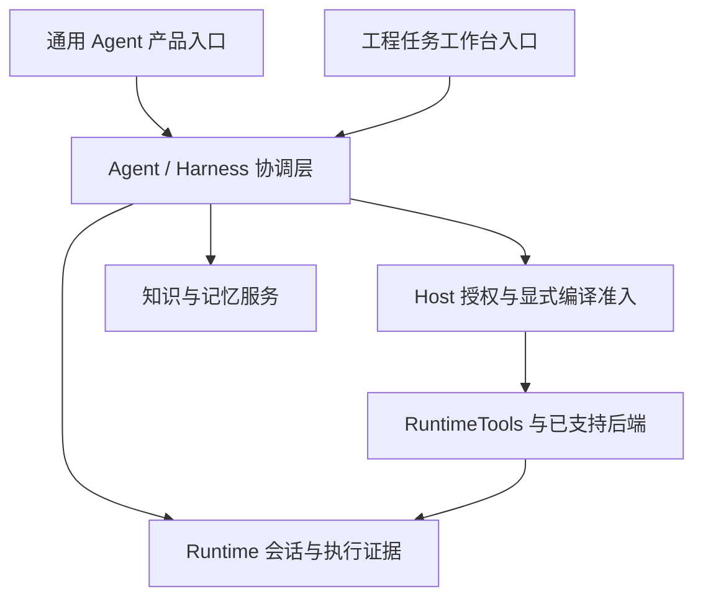

# TurboAgent 双路线产品设计与交付规划

状态：设计提案，2026-10-22。事实基线为 main
`d4897c0ac063494a63878b4e51d3453ef2e1894c`。本文描述产品路线和验收目标，
不表示完整工作台、持久任务服务、调度器或模型 Router 已经实现；实际公开契约优先。

## 1. 产品决策：共享内核，双路线交付

TurboAgent 同时推进两条具有独立用户流程、可交付版本和验收标准的路线：

| 路线 | 面向用户 | 核心体验 | 产品交付 |
| --- | --- | --- | --- |
| 通用 Agent | 个人用户、团队及应用宿主开发者 | 对话、资料与记忆、文档产出、跨应用办事、持续任务和专业 Agent 协作 | 可直接使用的通用助手，以及可嵌入宿主的原生内核与能力包 |
| 知识驱动的工程任务工作台 | 研发人员、工程资料维护者及专业软件用户 | 关联需求/代码/文档/日志，形成提案，执行获准操作并核对交付 | 面向工程资产、版本关系、变更和验收证据的工作台 |

通用 Agent 有自己的可用产品入口、默认场景和交付节奏。工程工作台有独立的工程对象、
关系提取器、验证规则和交互方式。两条路线共享基础设施，但各自形成可使用的体验。
通用产品化不以工程关系图完成为前提；工程只读切片不以通用连接器、调度或多模型 Router 完成为前提。

工程路线的详细场景及 M0–M4 计划见[工程任务工作台设计](engineering-task-workbench.md)。
本文的 G0–G3 是通用路线阶段，M0–M4 是工程路线阶段，编号不表示两条路线之间的先后关系。
两条路线都按切片验收，不以创建两套 Runtime、权限系统或数据存储实现“独立”。

## 2. 架构与共享边界

图表示职责关系。模型/工具循环与显式 compiled 模式仍按各自契约执行；当前同步 compiled
Inspect 的集成不能被解释为所有入口均已编译准入。失败的 compiled 计划不得隐式进入循环执行。

| 共享层 | 统一负责 | 产品层提供 |
| --- | --- | --- |
| Provider 与上下文 | 模型适配、规范消息、上下文预算与已有压缩机制 | 角色、模型选择配置、场景指令；自动 Router 另行验收 |
| RuntimeTools 与准入 | 工具身份、输入/结果契约、能力/效果、Host grant 和执行适配 | 业务工具与具体资源范围；工具说明和知识内容不授予权限 |
| Agent/Harness | Session、任务提交与控制；未来通用 Job/提案协调 | 通用助理或工程工作台的任务输入、完成条件和交互 |
| Runtime | Run/Checkpoint、既有结果/journal、受支持的重放与恢复 | 引用执行证据；不复制第二份可独立改写的持久结果 |
| 知识与记忆 | 复用已有 KnowledgeStore、MemoryStore 与检索接口，明确各自数据权威 | 资料源、记忆范围、展示与管理方式；记忆管理体验仍需实现 |
| 能力包与查询投影 | 一套工具/状态/结果契约，可被多个入口复用 | 通用文档与连接器能力，或工程对象/关系/验证能力 |

工程特有的源码符号、测试、构建目标、版本关系和 sidecar 索引位于工程能力包/投影层。
Runtime 保持领域无关。用户手工提案和记忆是其所属 owner 的持久数据，不能随工程索引重建丢失。

两条路线采用同一份 [Skill 与 YAML 工作流能力包设计](skill-workflow-packages.md)：
Skill 组织方法和输入，Host 注册的工具执行获准动作，稳定多步骤可选用已审查的 YAML 宏工具。
包声明不授予权限；版本绑定、结果验证和失败恢复按实际执行路径分别验收，不另建执行器或结果权威。

两条产品入口可选择同一个部署中的服务，但单用户/单写者及 backend 的实际限制继续有效。
同一任务由一个协调 owner 控制；未来 Job 引用既有 Run/attempt，更新和恢复遵守同一发布协议。
不同身份/宿主的共享需要显式授权和命名空间；首版不据此宣称多租户隔离。

## 3. 通用 Agent 的产品定义

用户可以直接开始资料问答、文档整理和任务委托，逐步增加个人记忆、连接器、事件触发及专业 Agent。
宿主开发者可以选择相同的内核和能力包接入自己的界面；模型和执行位置由 Host 配置。

| 能力 | 用户可见行为 | 设计边界 |
| --- | --- | --- |
| 对话与资料 | 选择资料、提问、查看引用，形成报告或文档草稿 | 明示选定来源、更新时间和缺失信息，资料中的指令不改变授权 |
| 角色与能力配置 | 选择研究、办公等角色，查看可用工具及资源范围 | 角色配置是指令与能力请求；实际能力由 Host grant 决定 |
| 记忆管理 | 查看、修正和删除已保存记忆，选择适用的身份/项目范围 | 复用明确的记忆权威，区分用户确认事实、模型建议和仍需保留的执行记录；不承诺未实现的全面数据擦除 |
| 持续任务 | 离开后查看进度，补充要求，取消或选择后续尝试 | 任意工具内挂起、跨进程后台持续运行和恢复需具体服务/协议支持 |
| 跨应用办事 | 连接邮箱、日历或业务应用，先形成提案再执行获准动作 | 每个连接器单独定义认证、范围、结果、取消和未知效果；不假设所有服务都支持撤销 |
| Agent 组合 | 把有界子任务交给专业 Agent，查看父子结果和阻塞原因 | 子 Agent 不能放大父级授权；失联、预算、取消和重复结果需监督协议 |

角色配置在产品层组合模型、知识、工具、授权范围、预算和输出目标。
稳定的配置版本和能力协商需对应切片实现；本文不新增未经实现的公开 AgentProfile C ABI。
通用入口和工程入口可以使用不同 UI，均需展示准确的任务状态、交付结果与后续动作。

## 4. 通用路线 G0–G3

| 阶段 | 独立交付 | 退出标准 |
| --- | --- | --- |
| G0 资料与文档助手 | 开箱可用的通用对话、选定资料查询、文档草稿、明确的 Host 导出和已完成会话继续 | 离线场景验证引用、文档产出、授权范围、存储重新打开和新一轮资料刷新；没有隐藏 shell/外发操作 |
| G1 记忆与持续任务 | 记忆查看/编辑/删除、版本化任务与目标、状态/交付视图、取消和受支持的恢复 | 完成通用 Job schema/发布恢复设计；记忆范围明确；失败交付不重复调用，未知效果显式阻塞 |
| G2 连接器与事件驱动 | 选择少量连接器、定时或事件触发、后台任务和结果通知 | 准确授权与身份映射、稳定触发身份、重复事件去重、凭据生命周期、失败/取消/重启门禁通过 |
| G3 Agent 组合与模型路由 | 有界子任务委托、专业 Agent 配置、按任务与预算选择模型 | #213 对应 Router/失联监督/预算/取消/重复结果验收；用实测质量、费用与延迟评估选择 |

G0 复用当前 CLI 的 general/检索/会话基础形成完整体验。
当前 general 模式工具注册范围不因本规划自动扩大。草稿保存先由用户明确的 Host 导出动作完成；
如果增加文档工具，须单独定义有界参数、目标资源、内容校验和 grant，不能默认开放 shell。

G1 与工程 M1 共同消费通用任务协调层；该层保持目标、输入和完成条件可扩展，不硬编码代码仓库或测试。
G2 的调度 owner 负责触发和投递任务请求，由既有协调/执行 owner 产生结果，不能另建任务执行权威。
通知发送也是明确授权的外部动作；触发去重不等于端到端 exactly-once 效果保证。
G3 复用现有 subagent/handoff 基础，动态创建、跨模型路由和失联恢复的完整保证需要新增实现与验证。
语音与其他模态沿各自已定义接口推进，保持可选，不阻塞 G0/G1 或 M0/M1。

## 5. 工程路线 M0–M4 与共享交付

| 工程阶段 | 工程专属交付 | 与通用路线的复用点 |
| --- | --- | --- |
| M0 只读证据分析 | 选定代码/文档/日志、直接关系、版本与新鲜度 | 与 G0 共用检索、引用、上下文和交付视图基础 |
| M1 单步任务 | 不可变提案、一个 compiled Inspect、现有 attempt 关联 | 与 G1 共用 Job/提案身份、状态控制和结果引用；各自按实际模式准入 |
| M2 Change/Repair | 修改提案、实际 diff、测试和验收证据 | 共用精确授权、任务取消、未知效果与恢复协议；工程验证器独立 |
| M3 多阶段工程流程 | 已审查构建/测试宏工具、阶段依赖和有限子任务 | 共用有界任务组合及连接器；Praktor 保持可选 |
| M4 工程扩展 | 更深代码关系/影响分析、适用的动态 Provider 和宿主集成 | 按已验收能力复用 G2/G3，保留专属提取器及平台门禁 |

原工程规划中 M4 的扩展列表保留为跨路线接入点。模型 Router 的主交付归 G3；
连接器/事件调度的主交付归 G2；工程层只消费其已验收能力，不另建平行实现。

## 6. 首批两个独立场景

### G0：个人资料到可继续加工的文档草稿

用户选择三份非工程资料，要求整理带来源的摘要或周报。助手展示引用和不确定项，
用户可修改要求并通过 Host 导出草稿。进程关闭后重新打开已完成会话，再对更新后的选定资料
提出后续问题；新一轮重新准备上下文，不沿用陈旧检索层。

离线夹具验证来源/版本、内容和格式、明确导出路径及失败语义、Host 授权边界、
已完成会话的继续、记忆/检索层的范围及错误引用拒绝。草稿质量由固定样例和人工核对评估；
对话通顺或模型自评不直接判定任务完成。付费模型和外部连接器不作为第一批离线验证前提。

### M0：代码、说明和失败日志的证据分析

沿用[工程 M0 的输入、关系范围和验收夹具](engineering-task-workbench.md#7-首个实施切片m0)。
第一版不依赖完整语义代码图或自动 CI 服务；来源缺失和关系未建立均可见。
完整变更影响分析、证据过期提示和定向复验按提取器/版本/验证规则分步接入，不能当作 M0 已有能力。

### 共同实施节奏

两条路线分别准备场景夹具和小型适配 PR，共享更改只进入所属模块一次。
共同基础变化要在通用资料任务和工程任务上各跑对应场景，避免领域假设进入公共接口。
首批能力包为有界文档渲染/引用检查与已审查构建/测试；候选契约、Host 导出边界和接入顺序见
[能力包首批交付](skill-workflow-packages.md#7-两条路线的首批能力包)，均为待实现切片。
先交付 G0 与 M0，再按明确依赖推进 G1/M1；各自的连接器、工程流程或多模型扩展按对应门禁推进。
这表示产品切片的交付顺序，不要求为规划启动重复 CI 或批量创建长期 Draft 堆栈。

## 7. 统一契约与分别验收

两条路线共享预授权与必要确认机制：现有 grant 范围内连续执行，越界或绑定前提改变时
重新评估；模型、资料、Skills 和子 Agent 均不能授予新权限。
策略更新继续由 Host 在 quiescent 安全点串行执行，generation 不提供并发策略替换同步。

提交结果、未知效果、交付失败和重试沿用一个规范结果权威。持久 Job、连接器、触发器和通知
各自定义故障窗口，不以一次普通 CI 或单条原子 claim 宣称全面恢复保证。

| 验收范围 | 通用 Agent | 工程工作台 |
| --- | --- | --- |
| 交付 | 草稿内容、引用、格式和获准保存/外部动作结果 | diff、目标行为、实际测试/构建结果和证据版本 |
| 持续工作 | 会话继续、记忆管理、触发/通知状态和跨应用失败 | 提案变更、来源过期、工程尝试、验证失效与复验 |
| 控制与恢复 | 准确 grant、取消、重复事件/结果、未知副作用 | 同一共享协议，加工程工具提交边界及 backend conformance |
| 成效 | 固定通用任务集的质量、人工接管、成本与延迟 | 固定工程任务集的成功率、引用正确性、验证覆盖与恢复结果 |

兼容已有存储、公共 API 和 SDK。共享 Job/记忆/审查记录的 schema、迁移和回退需在对应实现前设计，
不因两条产品路线同时存在而自动合并 KnowledgeStore/MemoryStore/RuntimeStore 或复制数据权威。

## 8. 责任映射和当前状态

#72/#73/#74/#77 继续承接执行准入、后端一致性、恢复和授权契约；其具体执行模式的退出条件继续有效。
#75/#76 承接图/状态版本边界；#213 承接 G3；#35 及语音相关 #137/#167/#184 保持独立可选验收。
连接器、任务调度和记忆管理的具体实现应在切片开始时核对现有跟踪项，再建立必要的聚焦任务，
避免把所有产品需求塞进执行 conformance issue 或新建重复总括 epic。

当前已有的模型适配、模块化 API、CLI、知识检索、Session/Runtime、subagent 和同步 compiled Inspect
是两条路线共同可复用的基础。完整通用助手产品与工程任务工作台均需按上述切片继续实现。
本文只确立两条路线和交付边界，不授权发布、合并、模型下载或付费调用。
