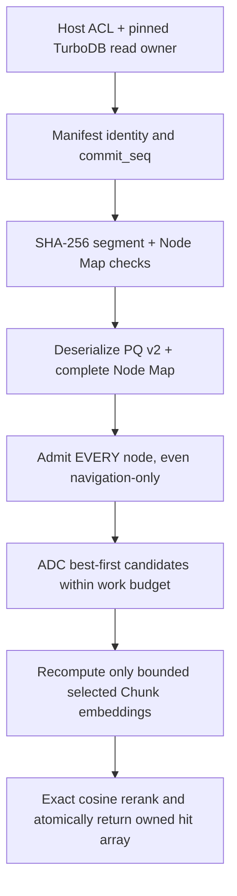

# LEANN-C11 L1b — pinned compact retrieval and selective recompute

**State:** private C11 algorithm/integration seam in Draft PR #305. No live
TurboDB connection or production KnowledgeStore replacement. Depends on
TurboAgent #304 SourceRevision / Chunk key contract, #298 generation publish,
TurboDB #220/#222 single-writer revision projection.

## Design

The validated L1a compact segment contains one node-local PQ code per
subquantizer plus shared codebooks, immutable graph CSR and opaque 16-byte
labels. The existing L0.5 Node Map carries the exact variable-length
SourceRevision/Chunk keys. This slice **reuses the same single Node Map decoder
and full admission callback** for both FP32 exact and PQ search; it does not
introduce a second key codec or SQLite wrapper.

## Private C11 surfaces

- `turbo_leann_search_pinned_adc`: returns bounded **approximate squared L2**
  and canonical borrowed Chunk/SourceRevision key views. Does not return exact
  cosine scores or claim recall parity.
- `turbo_leann_search_pinned_recompute`: accepts `candidate_k` with
  `top_k <= candidate_k <= 1024`, a finite `max_distance_evaluations`, a
  cumulative source-byte quota and a **Host-supplied** synchronous
  `turbo_leann_recompute_fn`. ADC first selects candidates, then only those
  candidates request exact immutable embeddings through that callback.
- Every callback gets the SAME pinned owner, exact canonical keys, requested
  dimensions and remaining source-byte quota. It must use the manifest's
  exact provider/model revision/embedding preprocessing identity; this library
  intentionally cannot download models or infer an embedding provider.
- Recomputed vector components are initialized to NaN before callback.
  Incomplete writes, NaNs, infinities and zero norms are rejected; all
  cosine scores are recomputed from fully written finite vectors.
- Any missing historical content, Host ACL denial, wrong generation, model,
  scope, digest, damaged map, callback error or source-byte overrun returns
  an explicit non-OK status with **zero published hits**. No ADC fallback.
- Results borrow canonical key bytes from the pinned Node Map; the caller
  must keep both byte blobs and the read lease alive while consuming them.

**Not a security boundary by itself:** the caller must ensure that the pinned
owner retains its Host authorization lease for the entire synchronous call,
that per-node callbacks validate full SourceRevision membership and current
revocation state, and that the `sha256` callback is the actual authenticated
provider. The fake test callback is purposely not cryptographic. A scope
fingerprint alone cannot authorize a whole ANN shard; serving cross-tenant
nodes through a shared shard is forbidden unless all traversal nodes are
independently authorized. Never rely on Top-K post-filtering for ACL.

## Local evidence

Tests use 8 immutable fake SourceRevision chunks and a same-owner fake read.
With `candidate_k=8`, all candidates are recomputed and the final Top-3
exact cosine scores/labels equal L0 exact retrieval. The private fake verifies
rejected Host admission before any recompute, failure on the third recompute
without partial hits, too-large claimed source bytes, partially unwritten
embedding, wrong generation/ACL, corrupted segment and map digests.

Recompiling the unchanged L0 and L0.5 tests, plus the L1a PQ test, with
GCC Release `-Wconversion -Werror` and Clang ASan/UBSan passed locally.
These are algorithm and callback tests, not exact-head official CI,
provider SHA-256 evidence or live SQLite crash-injection proof.

## Remaining gates

- Replace fake read with the real Agent #304 owner adapter over a pinned
  TurboDB `turbodb_revision_read_t` after #221/#223/#224 qualify and merge.
- Ensure both validated fingerprints and actual model/preprocess identity
  are bound to published segment generation, with mandatory Host permission.
- Stage packed segment, Node Map, FTS/Graph projections and HEAD in ONE
  TurboDB writer transaction; use `request_id` after `COMMIT_UNKNOWN`.
- Explicitly distinguish retained-but-unavailable historical source text
  from live current filesystem bytes. Never regenerate older embeddings from
  current paths or let removal/tombstones restore revoked content.
- Benchmark bounded candidate_k vs Recall@10/20, p50/p95/p99, peak memory,
  cold-start latency, large source corpora and mixed ACL memberships.
- Hub-preserving pruning and true multi-level HNSW remain separate work;
  L0's deterministic kNN ring + CSR is NOT a replacement for them.
