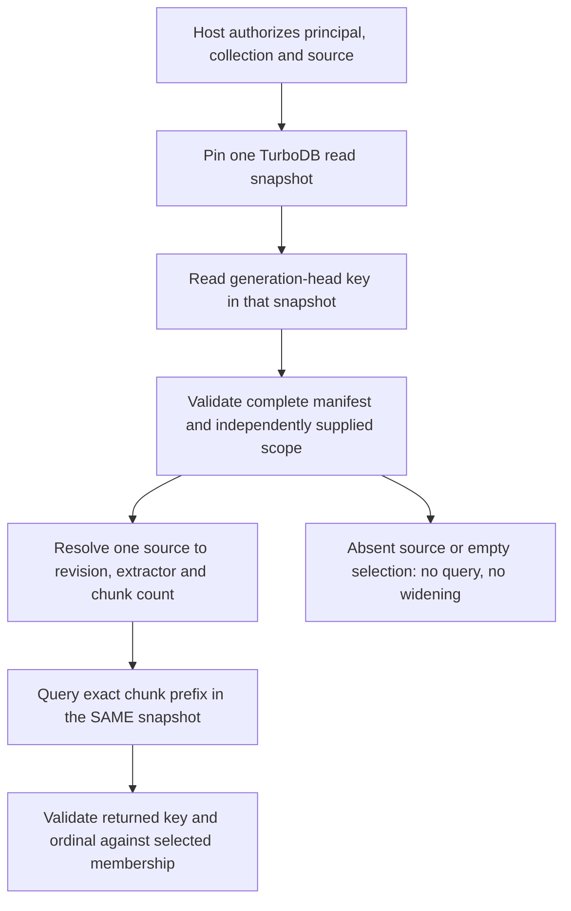

# Revision-generation membership (private candidate)

Tracks #294 / #298 / #300, under the #293 index epic. Extends the private
`turbo_agent_revision_keys` contract in Draft PR #304. This is a bounded C11
manifest codec and resolver, not a persistence adapter, public ABI or ACL
implementation. The production KnowledgeStore, Runtime, Journal and MemoryStore
are unchanged. There is no new TurboDB dependency or database owner.

## Why the generation is necessary

TurboDB's historical per-key lookup does not pick a current SourceRevision when
chunk keys contain different revision IDs. Both old and new immutable keys can
exist in one database snapshot. An FTS query over a broad source prefix may
therefore return both. The Agent must first resolve the exact source revision
and extraction identity selected by the published generation, then use the
existing exact chunk-prefix codec. Namespace/prefix filters alone do not grant
permission.



The diagram is the required future integration flow. Only the manifest
validation, selection, prefix construction and structural key checks are
implemented here. There is no database call and no claim that a generation was
atomically published, that referenced chunks exist, or that retained content
can be recovered.

## Canonical bounded record

```text
TAG + version byte 1
Agent generation_id : u64 big-endian, nonzero
scope.authority     : u16 byte length + opaque bytes
scope.collection    : u16 byte length + opaque bytes
member_count        : u16 big-endian
member_count records:
  source            : u16 byte length + opaque bytes
  revision          : u16 byte length + opaque bytes
  extraction        : u16 byte length + opaque bytes
  chunk_count       : u64 big-endian
```

IDs use the existing 256-byte bound, without normalization or text parsing.
Sources must be strictly increasing in binary lexicographic order. Duplicate
sources, contradictory selections, unsorted records, unknown versions,
truncation and trailing bytes are rejected. Decoders validate the complete
record before publishing a borrowed view or resolving a source.

This initial complete manifest supports at most 64 sources in one bounded
collection, 65,536 encoded bytes and 1,048,576 chunks per selected source.
Exceeding a limit is an explicit error, never truncation or a partial generation.
Larger collections require a separately designed bounded partition scheme;
do not interpret a page of members as a complete generation. Zero-source
manifests represent an empty published selection, not permission to search
all retained content. Zero chunks is valid for an empty source. Valid chunk
ordinals are strictly below `chunk_count`.

`generation_id` is an Agent selection identity, not a TurboDB `commit_seq`,
SourceRevision ID, timestamp or authorization token. Publication sequencing,
CAS and monotonic-generation policy belong to the future transaction adapter.

## Private C11 API and ownership

- `ta_revision_generation_encode`: deterministic complete-manifest encoding.
- `ta_revision_generation_decode`: validate all members against a separately
  supplied expected authority/collection; clear outputs on any failure.
- `ta_revision_generation_resolve`: exact source lookup; return the selected
  revision/extractor, chunk count, generation ID and an owned binary query prefix.
- `ta_revision_generation_accept_chunk`: require exact scope/source/revision/
  extractor membership and a valid ordinal.
- `ta_revision_generation_accept_edge`: require both source-revision endpoints
  in the same selection, for either incoming or outgoing encoded direction.

Decoded IDs and selected refs borrow the immutable input record. Retain the
underlying value until those views are no longer used. The constructed chunk
prefix owns its bytes. Outputs must not overlap input descriptors or bytes.
The resolver revalidates raw bytes rather than trusting a caller-modified decoded
view. The module allocates no heap memory and performs no I/O or implicit retry.

`NOT_FOUND` for source resolution is distinct from malformed data, a limit or
scope mismatch. Structural chunk/edge nonmembership returns success plus false;
malformed keys return an error. A true result proves only encoded membership:
it does not authorize access, prove payload integrity, validate graph relation
policy/evidence, or establish that a matching stored record exists. Edge checks
follow the current key contract's revision endpoints, not extraction provenance;
that must be verified from evidence records by the future adapter.

## Future atomic integration gate

The write adapter must validate source bytes and extraction results, write
immutable chunks and FTS projections plus both graph directions, and publish
the manifest at `ta_revision_generation_key(scope)` through the same TurboDB
write owner. On failure no partial generation may become visible. The read
adapter must load and resolve the manifest and perform every query through the
same pinned read transaction; it must not reread a live source head after
resolving an older generation. Historical reads use the retained historical
manifest; they do not repair it using current filesystem content.

Current Host grants and revocations are checked independently for every query,
including historical reads. A historical manifest cannot revive a revoked
grant. Missing content, malformed membership, unsupported partition size and
unknown commit outcomes must be explicit. No fallback to source-wide search.

## Tests

The SDK-independent test project compiles the exact production source, with no
SDK stubs or substitute store:

```sh
cmake -S agent/tests/revision_keys -B build/revision-keys -DCMAKE_BUILD_TYPE=Release
cmake --build build/revision-keys
ctest --test-dir build/revision-keys --output-on-failure --no-tests=error
```

The new `test_turbo_agent_revision_generation` covers old/new selection,
removed and adjacent source IDs, extractor changes, wrong scope, empty selection,
empty source, chunk ordinal bounds, graph endpoint versions, both directions,
every truncation of a fixture, duplicate/unsorted records, invalid lengths,
unknown versions, trailing data, maximal bounded manifests and cleared outputs.
It adds 10,000 deterministic canonical roundtrips, byte mutations and truncated
inputs. The unchanged key test retains its own 10,000 binary roundtrips.

Both register under the existing normal native Agent CTest build. Existing
macOS/Android jobs that disable general tests do not prove these tests ran.
No production storage migration is enabled by passing this suite.
