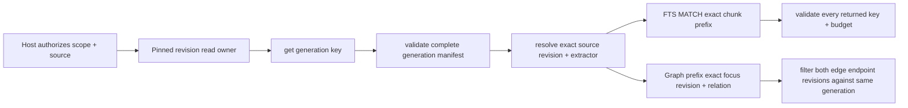

# Pinned revision read adapter (private candidate)

Tracks #297 and #300, building on PR #304's private key and generation contracts.
This file describes a read-only integration seam; it does not add TurboDB as a
build dependency, open a second SQLite connection or change KnowledgeStore.

## One pinned owner, one generation

The adapter is intentionally unable to begin another read transaction. The
caller supplies one already pinned `read_owner`, and every backend callback is
invoked with that same owner. This prevents generation resolution at one live
head followed by content retrieval at another.

The three private namespaces are `agent.index.generation`,
`agent.index.chunk`, and `agent.index.graph`. A future write adapter must use
the same names and publish the generation record only in the transaction that
also writes its immutable chunks/FTS projections and both graph directions.

## Backend seam

`ta_revision_read_backend_ops_t` maps the minimal operations already present in
TurboDB Draft #224: exact get, bounded FTS search, bounded binary prefix scan,
cursor next and close. The backend receives finite item/result-byte/VM-step
budgets. The Agent independently counts every physical cursor row and bytes as
well; stale retained graph history cannot consume unlimited work while being
filtered.

A returned FTS key outside the exact selected revision/extractor prefix, or a
graph key outside the requested focus/relation prefix, is a backend contract
violation. Graph rows within the prefix but pointing to a revision outside the
selected generation are ordinary retained history and are skipped. Missing or
empty generation membership returns `NOT_FOUND` and never issues a broad FTS or
graph query.

The backend value object has an explicit release callback. That maps directly
to TurboDB's independently owned revision value without copying or borrowing it
across its lifetime. For graph traversal, the generation value remains owned
until the cursor closes because destination membership is checked against it.
For FTS, the generation value can be released after the exact owned chunk
prefix and count are resolved.

## Not authorization

`authorized_scope` and `authorized_source` names document the precondition; the
adapter does not derive or grant them. Host ACL/revocation must run before each
query, including historical reads. Generation membership cannot revive a
revoked grant. Graph relation/evidence/tool authorization is also outside this
module.

## Qualification before a real TurboDB bridge

The private fake backend test must prove: old and new pinned snapshots select
different revisions while both physical revisions coexist; removed/empty or
malformed membership performs no retrieval; malformed/out-of-prefix backend
results fail closed; graph history is filtered by both endpoint revisions; all
budgets are finite; and visitor aborts/cursor closure are deterministic.

Only after TurboDB #221/#223/#224 merge and expose the revision API through a
qualified SDK should a thin bridge translate these callbacks to
`turbodb_revision_read_get`, `turbodb_revision_read_search_text`,
`turbodb_revision_read_scan_prefix`, `turbodb_revision_scan_next` and
`turbodb_revision_scan_close`. There is no fallback bridge to direct SQLite.
