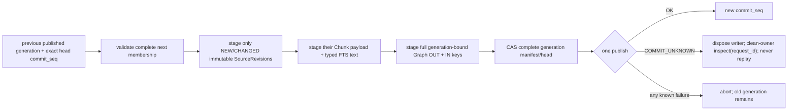

# Incremental revision write adapter (private candidate)

Tracks #295 / #296 / #298 / #300. This is a private C11 seam designed to map
onto TurboDB Draft #224 after its stacked upstream PRs merge and publish a
qualified SDK. It adds **no direct SQLite path**, no fallback provider, no
public installed ABI and no production KnowledgeStore migration.

## One active writer, one generation commit

The caller opens one backend write owner using a stable request ID. The adapter
consumes that owner on every return path and issues exactly one publish:

Every immutable SourceRevision uses
`ta_revision_source_revision_key(scope, source, revision)`. Chunk keys include
the exact SourceRevision and extractor. Graph OUT/IN keys include the **new
index_generation** plus both endpoint SourceRevision IDs. The complete
generation manifest is staged last and is the only mutable selection pointer in
this candidate.

## Incremental reuse

A new generation normally contains many unchanged sources. Rewriting their
immutable SourceRevision/Chunk/FTS rows with EXPECT_ABSENT would conflict and
would manufacture new history. The request therefore separates:

- `members`: the complete sorted membership of the generation being published;
- `staged_sources`: the exact sorted subset whose revision/extractor/chunks are
  NEW or CHANGED;
- `previous_generation`: the complete previously published manifest read
  before the writer was opened;
- `expected_generation_head_seq`: exact CAS against that previous generation
  head. `EXPECT_ANY` is rejected.

For every member unchanged from `previous_generation`, staging it again is an
error. Every new/changed member must be staged exactly once. A nonzero expected
head requires a valid previous manifest, and the new Agent generation ID must be
strictly greater. Removed sources simply disappear from the new complete
manifest.

This relies on the retention rule already required by #298: records referenced
by the currently published generation cannot be garbage-collected while that
generation remains current. The exact head CAS prevents publishing a candidate
built from a concurrently replaced generation.

## Backend mapping

The private callback seam corresponds narrowly to the current TurboDB revision
contract:

- `put(..., EXPECT_ABSENT)` for new SourceRevision, Chunk and generation-bound
  Graph keys;
- `project_text()` immediately after the same new Chunk put;
- `put(generation_key, ..., expected_generation_head_seq)` for publication CAS;
- one `publish()`;
- `abort()` only disposes an unconsumed/quarantined writer.

A backend returning COMMIT_UNKNOWN from a **staging** operation is a contract
violation. Only publish may be uncertain. When publish returns COMMIT_UNKNOWN,
the adapter disposes the writer and returns COMMIT_UNKNOWN with no commit_seq;
the caller must reopen a clean DB owner and inspect the original request ID.
There is no automatic retry.

## Bounds and authority

The request has explicit maximum newly staged chunks, current-generation logical
edges and total staged key/value/text bytes. All structural membership and edge
endpoint checks happen before the first backend mutation.

This layer does **not** authorize a principal, source, relation, evidence or
tool. Host ACL/revocation checks happen before opening the writer. FTS text is
assumed to be already validated extracted text; this candidate rejects embedded
NUL but does not introduce a second UTF-8 parser.

The mutable `source_head` key class is intentionally not written here. The
generation manifest is the selected revision/extractor authority for queries.
If #295 later requires a separate per-source current-head cache, it needs its
own exact CAS semantics and must be staged in this same owner; it cannot become a
second publication path.

## Current qualification

Standalone tests use a fake single-owner backend and the exact production
private key/generation code. They cover initial and incremental generations,
unchanged-source reuse, changed-source staging, generation monotonicity, graph
generation identity, full OUT/IN publication, generation-head CAS, finite
budgets, staging failure, backend contract violations and COMMIT_UNKNOWN without
replay.

Passing this test does not prove the real TurboDB bridge or crash durability.
The real bridge remains blocked on upstream #221/#223/#224 merging and installed
SDK qualification, then must reuse the existing SQLite VFS/process-crash
fixtures before any production cutover.

## SourceRevision record semantics

SourceRevision metadata is no longer an opaque write payload. The private
`ta_source_revision_record_t` TAR v2 encodes original-content length, explicit digest
semantics, retention state, source mtime and observation time into a fixed 64-byte
versioned record. Both timestamps are Unix seconds and are provenance only; they
are never used as unchanged-content proof or authorization.

`UNVERIFIED_LEGACY` means the legacy KnowledgeStore hash cannot be proven to
be SHA-256 of the original source bytes (the current legacy path includes
extracted-text FNV64). It therefore requires `CONTENT_UNAVAILABLE` and a zero
SHA-256 field. It is invalid to reinterpret such a migrated value as retained,
verified original content.

`SHA256_ORIGINAL` means Host ingestion actually hashed the original source
bytes. Only that digest semantic may carry `CONTENT_RETAINED_VERIFIED`.
The codec records this assertion but does not compute the digest; original-byte
verification remains the ingestion owner's responsibility.

## Unknown-commit reconciliation

A publish-time `COMMIT_UNKNOWN` is terminal for the original write owner. The
private reconciliation API accepts only a **clean, newly opened/read-only
owner** and the original bounded request ID. It returns exactly:

- `COMMITTED(commit_seq)`,
- `NOT_COMMITTED`,
- typed invalid/backend/backend-contract failure.

There is deliberately no replay/retry callback in this API. A zero commit
sequence returned as a successful inspection is a backend-contract violation.
Staging-time `COMMIT_UNKNOWN` is likewise a backend-contract violation because
only SQLite COMMIT acknowledgement may be uncertain.

## Empty legacy documents

The current KnowledgeStore stores one zero-length chunk for an empty document.
TurboDB's typed FTS projection rejects a zero-length body. The Agent adapter
therefore stages the zero-length Chunk value but intentionally skips
`project_text` for that chunk. This preserves the historical document/chunk
shape without inventing searchable text or weakening TurboDB's FTS contract.
