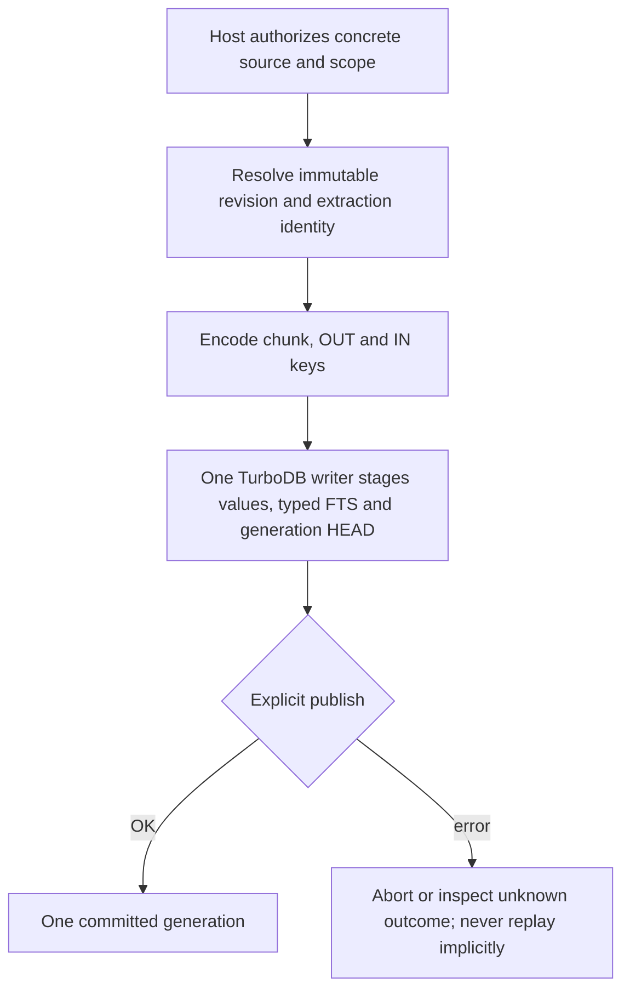

# Revisioned LocalDB: private key contract

Status: implementation candidate for #294 / #300. This is **not** the production
KnowledgeStore adapter, an ACL implementation, or a published file format.
The existing KnowledgeStore, Runtime, Journal and MemoryStore are unchanged.
No TurboDB dependency, schema migration, public installed header or new
persistence owner is introduced by this slice.

## Why the Agent needs its own identity layer

TurboDB's revisioned store assigns a database `commit_seq`; its FTS query resolves
the latest value **of each exact binary key** at that sequence. That is not the
same as the currently selected `SourceRevision` of a source. If revision IDs are
part of immutable chunk keys, a source-wide prefix can match both the old and the
new revision. A caller must first resolve the authorized published generation
and its source/revision/extraction membership in the **same read snapshot**, then
query each exact revision/extraction prefix. Do not infer current membership
from a URI prefix, content hash, largest timestamp or an FTS hit.

This change supplies the pure C11 identity encoding needed for that adapter.
It does not yet resolve generation membership or invoke TurboDB.

## Canonical encoding (candidate version 1)

`I(x)` means a two-byte unsigned big-endian length followed by exactly those
opaque bytes. Every ID is nonempty and at most 256 bytes. An entire key is at
most 4096 bytes. No delimiter concatenation, escaping, UTF-8 normalization,
filesystem path resolution, hashing or implicit aliases are used.

```text
scope = 'T' 'A' 'I' 0x01 | I(authority_scope) | I(collection_id)

chunk-prefix = scope | 0x01 | I(source_id) | I(revision_id) | I(extraction_id)
chunk-key    = chunk-prefix | uint64-big-endian(chunk_ordinal)
source-head  = scope | 0x02 | I(source_id)
generation   = scope | 0x03

out-prefix = scope | 0x04 | I(from_source) | I(from_revision) | I(relation)
out-key    = out-prefix | I(to_source) | I(to_revision) | I(edge_id)
in-prefix  = scope | 0x05 | I(to_source) | I(to_revision) | I(relation)
in-key     = in-prefix | I(from_source) | I(from_revision) | I(edge_id)
```

The same logical edge has both directional keys, and the same `edge_id` and
revision endpoints. Multiple evidence-bearing relations between the same pair
remain distinguishable. An edge's evidence payload and its validation are the
future adapter's responsibility; a correctly encoded key proves neither the
relationship nor a tool action. This slice only addresses SourceRevision
endpoints, not a new executor graph or generic node-type registry.

The source and generation HEAD **keys** are stable lookup identities; their
future values will be versioned by TurboDB. `commit_seq`, `revision_id`,
`extraction_id` and `index_generation` remain distinct concepts. Filesystem
renames change path metadata, not these logical IDs; rename proof is outside
this codec.

## API and ownership

Private source: `agent/src/turbo_agent_revision_keys.{h,c}`.

```c
ta_revision_chunk_prefix(&ref, &query_prefix);
ta_revision_chunk_key(&ref, ordinal, &chunk_key);
ta_revision_chunk_decode(encoded, &borrowed_ref, &ordinal);
ta_revision_chunk_matches(encoded, &expected_ref);
ta_revision_edge_key(&edge, TA_REVISION_EDGE_OUT, &out_key);
ta_revision_edge_key(&edge, TA_REVISION_EDGE_IN, &in_key);
```

Inputs are bounded byte views borrowed during the call. Encoded outputs are
caller-owned fixed buffers, cleared on failure with no partially published
key. Decoders return borrowed views and reject wrong versions, kinds, invalid
lengths, missing fields and trailing bytes. No heap allocation, I/O, retry,
fallback or global state occurs. Numeric ordinals use byte ordering independent
of host endianness.

**Authorization happens before encoding.** The Host must validate each requested
authority/collection/source/revision against the calling principal and current
grant state. A caller must not gain permission merely by supplying identifiers
or by passing `ta_revision_chunk_matches`. That function compares content
identity, not an ACL. Cross-scope graph links require a separate explicit policy;
this layout represents one declared scope, not a permission escalation path.

## Required future adapter transaction



For reads, acquire one bounded TurboDB read lease, resolve the committed
generation membership, encode exact chunk prefixes, then run scoped FTS and
validate the returned keys against the expected tuple. Never merge results from
different snapshots or treat a truncated scan as complete. Forward and reverse
edges, evidence references and generation HEAD must be written in the same
batch. This transaction path is **not implemented here**.

## Test evidence and remaining gates

The standalone C11 project at `agent/tests/revision_keys` compiles the real codec
source without SDK/header stubs. It is also registered with normal native Agent
CTest through `agent/CMakeLists.txt`.

Tests cover neighboring IDs, delimiter ambiguity, embedded NUL/0xff bytes,
revision/extractor changes, ordinal ordering through UINT64_MAX, directional
edge roundtrip, unknown formats, every truncated chunk-key length, bounded
fields, output clearing, and 10,000 deterministic randomized roundtrips.

Local validation: GCC 14.2.0 and Clang 17.0.0, `-std=c11 -Wall -Wextra -Wpedantic
-Wconversion -Werror`; Clang AddressSanitizer/UndefinedBehaviorSanitizer with
leak detection. This proves the codec only, not Windows/macOS or storage/ACL
integration. Existing CI decides native/cross profiles; no old gate is disabled.

Next gates remain the actual TurboDB-backed Agent batch/read adapter, validated
generation membership, Host grant mapping and revocation, KnowledgeStore
migration, retained content/evidence lifecycle and application-level crash
recovery. Upstream Draft PRs qigao/turbodb#221, #223 and #224 are not merged by
this change. Do not switch production or close #294/#300 on codec tests alone.
