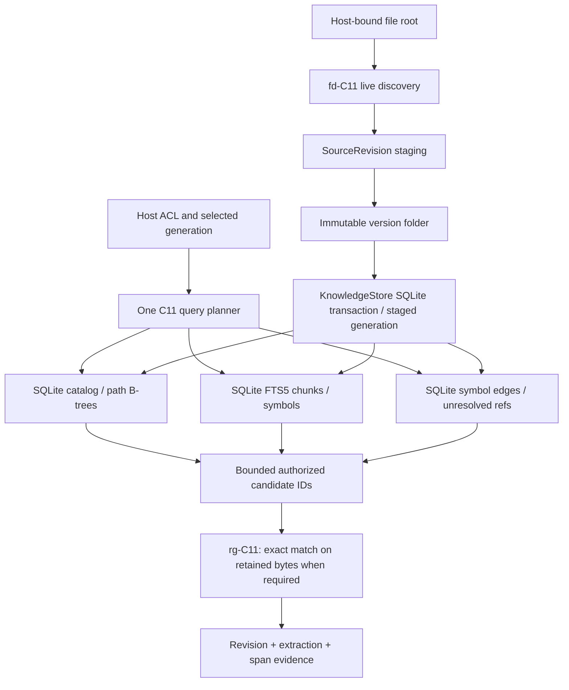

# ADR: Versioned file search with SQLite FTS5 and native C11 CodeGraph projections

**Status:** design candidate, not implemented or published. **Date:** 2026-10-30.
**Canonical tracker:** [#306](https://github.com/qigao/TurboAgent/issues/306).
**Delivery trackers:** [FTS5 #307](https://github.com/qigao/TurboAgent/issues/307), [CodeGraph #308](https://github.com/qigao/TurboAgent/issues/308), [identity #294](https://github.com/qigao/TurboAgent/issues/294), [ingest #295](https://github.com/qigao/TurboAgent/issues/295), [retrieval #297](https://github.com/qigao/TurboAgent/issues/297), [publication #298](https://github.com/qigao/TurboAgent/issues/298), [LocalDB #300](https://github.com/qigao/TurboAgent/issues/300).
**SQLite owner:** the existing `turbo_agent_knowledge_store_t` connection/transaction owner and native SQLite3/FTS5 API. The optional `TurboDB::SqliteRevision` design ([TurboDB #220](https://github.com/qigao/turbodb/issues/220)/[#222](https://github.com/qigao/turbodb/issues/222), Draft PRs #221/#223/#224) has been **superseded and retired**; none of it is an implementation prerequisite. Do not introduce per-key MVCC or a new SQLite/KV wrapper.
**Filesystem prerequisite:** [SaltsCore FS #108](https://github.com/qigao/salts-core/issues/108) — durable no-replace directory publication; the existing file-only replacement API is insufficient.

**Retired prototypes:** LEANN [Agent #299](https://github.com/qigao/TurboAgent/issues/299) / Draft [#305](https://github.com/qigao/TurboAgent/pull/305), and the `SqliteRevision`-bound Agent Draft [#304](https://github.com/qigao/TurboAgent/pull/304). Their source and tests remain available as Git history for selective porting, not as accepted production dependencies. [New search #306](https://github.com/qigao/TurboAgent/issues/306), [FTS5 #307](https://github.com/qigao/TurboAgent/issues/307), [CodeGraph #308](https://github.com/qigao/TurboAgent/issues/308) and [publication #298](https://github.com/qigao/TurboAgent/issues/298) own the remaining work.

This ADR supersedes ANN-first or independent authoritative graph/file index-store designs for this product. It does **not** delete an existing vector API, approve production migration or a release, merge Draft PR #304/#305, or claim implementation/CI acceptance.

## 1. Decision and owner boundaries

- Original bytes and historical file material: **immutable generation folders**, with content checksums and explicit retention. A version folder contains only changed original objects; unchanged SourceRevisions reference previously retained files. A materialized full-tree export is optional, not required for every generation.
- Identity, selected source/revision membership, extracted UTF-8 chunks, metadata, full-text token postings, code symbols/relations and published generation pointer: **one logical SQLite KnowledgeStore** owned by TurboAgent application semantics and the existing native SQLite3 connection/transaction layer (no new Revisioned SQLite target).
- File discovery, ignore/glob and bounded live change enumeration: **fd-like C11**, reusing the existing Host-authorized Salts/CMeta filesystem-root capability rather than shelling out to fd.
- Byte-accurate literal, regex, line/column and bounded original-file scan: **rg-like C11**. Its exact matcher is an explicit query plan. A matching indexed token is never treated as proof of an exact source-byte span.
- **SQLite FTS5** is the primary indexed lexical retrieval path: chunk text plus symbol names/qualified names/signatures/docstrings. An optional Trigram posting index is only a candidate accelerator with proved superset semantics.
- **Tree-sitter native C runtime** parses code into a version-bound symbol/reference projection; SQLite B-trees store reverse/forward typed edges and unresolved references. No Rust CodeGraph runtime, Node runtime, independent graph DB, second parser or ANN/PQ engine is required.
- The current RuntimeStore, Journal, MemoryStore and Host grant authority are separate. Searchable graph relations **never** authorize Tool/Run execution. Keep #299/#305 as optional measured research, outside the P0 file-search path.



## 2. Folder versions and cross-resource publication

Proposed *logical* directory layout (names/final ABI need acceptance):

```text
knowledge/
  knowledge.sqlite
  versions/
    g000101/
      manifest.bin
      changed/<opaque-source-object>/content
    g000102/
      manifest.bin
      changed/<opaque-source-object>/content
  .staging/<request-id>/
```

Stable `source_id` is not a path or content hash. A `revision_id` belongs to one source and is immutable; an identical byte blob in two logical sources does **not** merge their identities. `extraction_id` records parser/grammar/preprocess/config versions. `generation_id` represents one published search view. `commit_seq` is **not** a required new storage-engine concept; any local commit ordering or `request_id` inspection is application-level metadata in the same SQLite database, not an extra revision KV database. Old evidence must resolve old bytes or return an explicit missing/not-retained status.

**Filesystem publication is not a SQLite transaction.** A safe production protocol must:

1. Stage bytes and manifests under a bounded unique request ID, hash exact input bytes, fsync content and staging directory.
2. Durably publish a **new**, previously absent immutable directory on the same volume (no replacement and no symlink traversal), and persist parent directory metadata where the platform guarantees it. If the platform cannot establish that contract, reject publication; do not silently downgrade.
3. With the **existing KnowledgeStore SQLite write owner**, use an explicit `BEGIN IMMEDIATE` transaction (or an exactly equivalent existing owner-managed transaction) to insert immutable SourceRevision/path/Chunk/extracted text, synchronize FTS5 postings, publish graph edges and generation membership, record the idempotent `request_id`, and CAS the Generation HEAD, followed by **one SQLite COMMIT**. No separate `RevisionStore`, generic `revision_values`/`revision_heads` or unrestricted raw SQL plugin is introduced. Only committed generations are query-visible.
4. On known pre-commit failure, old HEAD is visible; the unreferenced folder is an orphan. When SQLite COMMIT return/durability is ambiguous, treat the outcome as `COMMIT_UNKNOWN`: reopen a clean connection and inspect a UNIQUE `request_id` in the application generation-commit table. The record and HEAD must be modified in the **same transaction**. Never re-execute automatically.
5. Readers pin a **normal SQLite read transaction** (`BEGIN` and the first read establish its snapshot), resolve an immutable application Generation membership and a retention lease on that one owner, enforce current Host ACL, then read **immutable** version bytes under the retained root. This is not persistent SQLite `snapshot_get`/per-key MVCC. Validate digest and parse/extraction identity. Do not load a historical document from the current mutable path.
6. GC observes archived Generations, evidence, live readers, pending request inspection and retention. Orphan cleanup must never remove a folder referenced by any committed or pinned Generation.

**Important API gap:** SaltsCore `salts_fs_replace_durable()` is a *file* replacement API. It is not proof of cross-platform no-replace durable **directory** publication. Qualification belongs to #298 and [SaltsCore #108](https://github.com/qigao/salts-core/issues/108). No raw runtime SQLite schema changes, private SQLite B-tree use, or fake cross-system ACID claim.

## 3. Data and index projection

The SourceRevision and Legacy KnowledgeStore migrations are owned by #294/#295/#298/#300. The following is an illustrative target shape, **not** an already published SQL schema:

```sql
CREATE TABLE extracted_chunks (
  chunk_pk INTEGER PRIMARY KEY,
  source_id BLOB NOT NULL,
  revision_id BLOB NOT NULL,
  extraction_id BLOB NOT NULL,
  ordinal INTEGER NOT NULL,
  body TEXT NOT NULL,
  UNIQUE(revision_id, extraction_id, ordinal)
);

CREATE VIRTUAL TABLE chunks_fts USING fts5(
  body, content='extracted_chunks', content_rowid='chunk_pk',
  tokenize='unicode61'
);

CREATE TABLE symbol_occurrences (
  occurrence_pk INTEGER PRIMARY KEY,
  source_id BLOB NOT NULL,
  revision_id BLOB NOT NULL,
  extraction_id BLOB NOT NULL,
  kind TEXT NOT NULL,
  name TEXT NOT NULL,
  qualified_name TEXT NOT NULL,
  signature TEXT,
  docstring TEXT,
  start_byte INTEGER NOT NULL,
  end_byte INTEGER NOT NULL
);

CREATE VIRTUAL TABLE symbols_fts USING fts5(
  name, qualified_name, signature, docstring,
  content='symbol_occurrences', content_rowid='occurrence_pk',
  tokenize='unicode61'
);

CREATE TABLE generation_chunk_membership (
  generation_id INTEGER NOT NULL,
  chunk_pk INTEGER NOT NULL,
  PRIMARY KEY(generation_id, chunk_pk)
) WITHOUT ROWID;

-- Illustrative application-level durable publication, within this SAME DB.
-- Generation members and retained external files are application-versioned.
-- No per-key SQLite revision store or sqlite3_snapshot handle is required.
CREATE TABLE index_generation_commits (
  request_id BLOB PRIMARY KEY,
  generation_id INTEGER NOT NULL UNIQUE,
  manifest_digest BLOB NOT NULL CHECK(length(manifest_digest)=32)
);
CREATE TABLE index_generation_heads (
  scope_id BLOB PRIMARY KEY,
  generation_id INTEGER NOT NULL
);
```

- `extracted_chunks` and `symbol_occurrences` are **ROWID** tables because FTS5 External Content lookup needs a stable integer rowid. The separately keyed `generation_*_membership` and bounded graph adjacency can use `WITHOUT ROWID`.
- FTS5 stores **inverted postings**, not the original source files. External content fetches text from the corresponding SQLite content table; it does not read version folders. This avoids a second stored copy of extracted text inside the FTS5 table, not a second content index or total disk cost.
- Use prepared, fixed-schema C11 writes or versioned SQLite triggers in the **same existing KnowledgeStore write transaction**. The retired TurboDB #222/PR #224 prototype is not a prerequisite; no ad hoc model-generated SQL/DDL, new versioning wrapper or separate FTS writer. Deletions must update External Content FTS before base values become inaccessible.
- New FTS tables + triggers **do not backfill** old rows; explicit schema-version migration and FTS5 rebuild/readback are required. Legacy `documents.content_hash` may be FNV64 over extracted text; never rename it original-source SHA-256.
- Historical base rows and posting entries are retention-bound; deleting old-generation indexed rows before releasing pinned readers/evidence breaks historical queries.

### FTS5 tokenizer and CodeGraph naming rules

| Input | Primary plan | Notes |
| --- | --- | --- |
| Plain-language terms / phrases | `chunks_fts`, FTS5 `unicode61` + BM25 | Token retrieval, not exact bytes |
| Identifier name / qualified name | SQLite B-tree exact and `symbols_fts` | Preserve punctuation and overload ambiguity |
| snake_case / camelCase natural query | Explicit, versioned identifier-segment projection | Do not assume default FTS tokenizer splits it correctly |
| Source literal | rg-C11 exact scan | Optional FTS5 Trigram *candidate* only with no-false-negative proof |
| Regex | PCRE2 exact matcher | Only safe, proven necessary literals may narrow candidates |
| Callers / callees / impact | Versioned SQLite Graph B-tree | Traversal is bounded, and uncertain edges remain uncertain |

Trigram hazards: FTS5 MATCH with fewer than **three Unicode characters** matches no rows; some LIKE/GLOB patterns cause a full scan; `case_sensitive=1` changes indexed LIKE/GLOB capability; `detail=none/column` restricts long full-text query tokens; ESCAPE LIKE cannot be assumed indexed. Query-byte semantics, CJK normalization, case sensitivity, binary data and exact file offsets must always match the requested mode. Never use trigram as a lossy filter on the rg-C11 exact corpus.

## 4. One pinned, explicitly selected query plan

A query request identifies: Host-authorized scope/root/source set, published Generation (or explicit historical generation), selected mode, query text or bytes, identifier/extractor policy, top_k, maximum candidates, bytes, SQLite VM steps, matches, time and traversal depth.

| Mode | Candidate source | Proof / exit |
| --- | --- | --- |
| PATH | generation-scoped SQLite path B-tree | exact glob/ignore semantics; fd-C11 only for authorized *live* refresh |
| LEXICAL | FTS5 MATCH for selected indexed corpus | exact generation/scope membership and BM25 ranking |
| SYMBOL | B-tree exact name, FTS5 names + derived identifier segments | return ambiguous targets, never choose one silently |
| LITERAL | all authorized immutable sources or *proven complete* Trigram candidate set | rg-C11 exact byte spans, return explicit PARTIAL if incomplete |
| REGEX | same authorized source set or necessary-literal safe subset | bounded PCRE2, explicit unknown/limit/error statuses |
| GRAPH | bounded adjacency in one generation | evidence-qualified endpoints/edges and confidence |
| HYBRID | explicitly chosen above modes | fusion after membership checks, stable ID tie-break, complete/partial status |

Security and correctness: NEVER do global `top_k` then filter by ACL, Scope, Revision or Generation. Apply hard restrictions while obtaining candidate IDs and validate every resulting span against the pinned membership and current Host authorization. BM25's corpus-level statistics can incorporate terms from other scopes even if hits are filtered, so ranking confidentiality must be separately evaluated; a SQL predicate alone does not prove it. When strong tenant isolation is needed, design a trusted physically isolated indexed corpus or suitably scoped scoring, without a second application owner. Missing FTS5/invalid schema is an explicit unsupported/error, not silent LIKE search.

All returned results include source_id, revision_id, extraction_id, occurrence/chunk ID, span-space type (original bytes vs extracted UTF-8 vs document page), byte or line/page offsets, evidence provenance, index_generation, completeness and any limits reached.

## 5. CodeGraph-style symbol extraction

Source inspiration: [CodeGraph SQLite schema](https://github.com/colbymchenry/codegraph/blob/main/src/db/schema.sql), [symbol/edge traversal](https://github.com/colbymchenry/codegraph/blob/main/src/graph/traversal.ts), [node ID generation](https://github.com/colbymchenry/codegraph/blob/main/codegraph-kernel/src/ids.rs).

Tree-sitter native C runtime parses **retained immutable SourceRevision bytes**. Start with C/C++ and track exact parser/grammar/extractor/config fingerprint (e.g. compile commands, feature macros, include paths). The source span is the truth; AST parsing and dynamic inference do not establish that all calls resolve.

Proposed output: a bounded per-file deterministic bundle of Definitions, References, unresolved_refs, and typed edges (`DECLARES`, `REFERENCES`, `CALLS`, `IMPORTS`, `INCLUDES`, `EXTENDS`, `IMPLEMENTS`, `TESTS`). Each edge states origin occurrence/callsite and whether it is observed, exactly resolved, inferred/ambiguous or unresolved. C++ overload, macros, function pointers, vtables, generated code and conditional compilation can legitimately remain unresolved.

An `occurrence_id` binds one exact source_revision + extraction + span. Cross-revision logical `symbol_id` is a separately proven mapping; do not bind historical evidence to mutable file paths or line-based ID hashes. Ref tables retain unresolved/failed work for bounded future resolution when changed definitions or headers are ingested; never join references from old revisions to new definitions without a published membership rebind.

Graph read uses forward and reverse composite B-tree indexes, explicit hop/node/edge budgets, cycle detection, no unbounded recursive SQL, and exact-generation endpoint checks. The execution Graph/StateGraph is untouched. `context_for_task` produces bounded versioned evidence snippets with callers/callees/impact diagnostics, not an authorization or code execution grant.

## 6. Delivery and verification gates

1. **S0, design and provenance**: #306 + #293/#294, define folder no-replace publish, retention, native SQLite schema and request-ID/Generation contracts. Old LocalDB #300 and Revisioned SQLite/LEANN prototype PRs are archived as superseded; salvage identity/provenance tests in new, scoped PRs only. No production migration.
2. **S1, C11 fd discovery**: reuse existing Host root FS, deterministic bounded recursion, ignore/glob/no-follow symlink policy, file change coverage.
3. **S2, C11 rg-like exact search**: bounded literal and PCRE2 regex, cross-buffer matches, original byte offsets, cancellation, compare to real rg/fd on the same selected input version.
4. **S3, SQLite FTS5 [#307](https://github.com/qigao/TurboAgent/issues/307)**: external content chunk/symbol tables, same-owner update/backfill, version/scoped query planner and exhaustive exact-reference false-negative regression.
5. **S4, CodeGraph C11 [#308](https://github.com/qigao/TurboAgent/issues/308)**: Tree-sitter C symbols, unresolved references and versioned edges with precise provenance and C/C++ build-config identity.
6. **S5, durable generation [#298](https://github.com/qigao/TurboAgent/issues/298)**: filesystem-before-DB, fixed read-only SQLite transaction and immutable historical membership, same-transaction chunk/FTS/Graph/HEAD/request_id, `COMMIT_UNKNOWN` inspection and process-kill/VFS fault tests. **No `TurboDB::SqliteRevision` gate.**
7. **S6, migration and benchmarks**: preserve old KnowledgeStore URI/kind/title/metadata, compare versioned queries and impacts, old content absent/retained cases; 1K/10K/100K+ real repo corpora, cold/warm p50/p95/p99 latency, disk/RSS, churn, correctness; separately measure Agent tool calls/tokens/quality.

No speculative fallback parser/provider; no installer/consumer projects, separate probe workflows, new CI files or unfounded performance claims. Reuse existing project tests/CTest and cached toolchains. No merge, release or production switch until exact-HEAD native SQLite/FTS5, Host ACL, filesystem publication and crash-recovery acceptance are proven. The retired TurboDB revision SDK is not a build dependency.

## References

- [SQLite FTS5 official documentation](https://www.sqlite.org/fts5.html): External Content, Trigram, BM25, MATCH and integrity.
- [CodeGraph repository](https://github.com/colbymchenry/codegraph): architecture reference, **not** production dependency.
- [ripgrep](https://github.com/BurntSushi/ripgrep), [fd](https://github.com/sharkdp/fd), [Tree-sitter](https://tree-sitter.github.io/tree-sitter/): algorithmic/runtime references.
